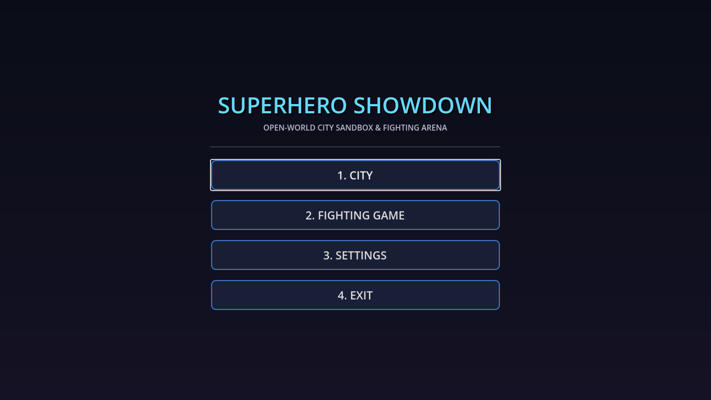
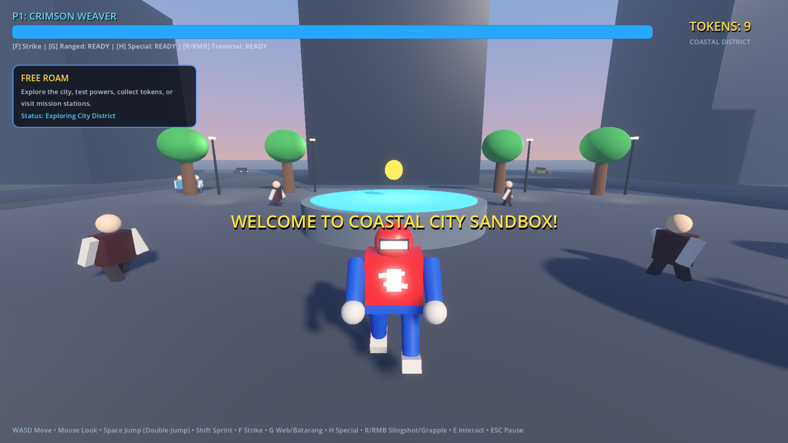
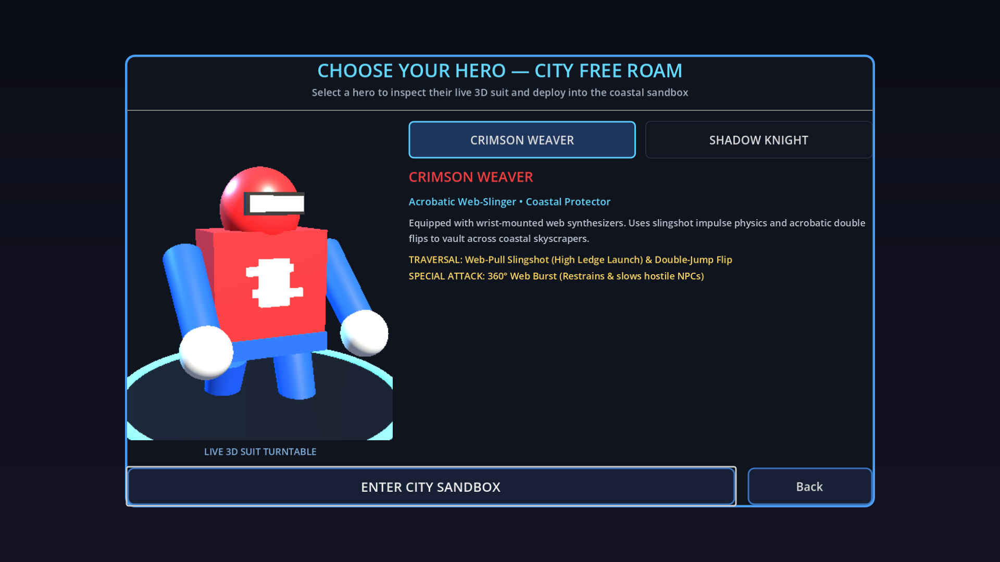
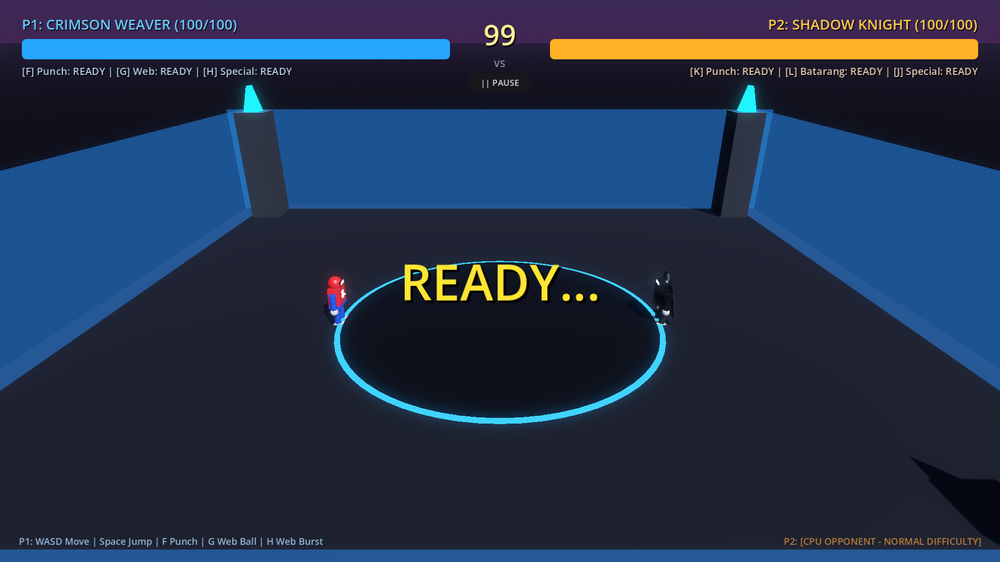
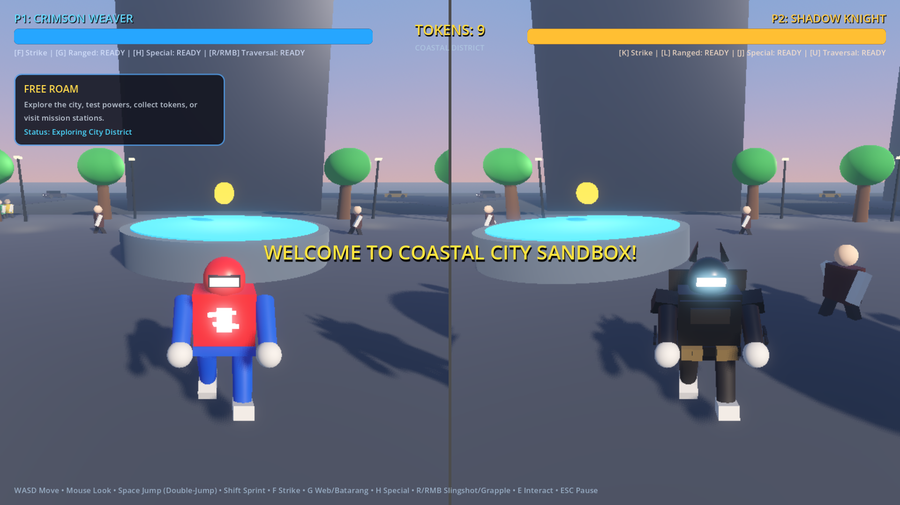

# Superhero Showdown: City Sandbox & Fighting Arena

An original 3D open-world superhero city sandbox and local fighting game developed in **Godot 4.7.2**.



This project features an explorable coastal city, acrobatic traversal mechanics, autonomous traffic, ambient pedestrians, hostile street syndicates, interactive rooftop missions, a dedicated local fighting arena, and an integrated 5-tab settings system.

---

## Features

### 1. Open-World City Sandbox

- **City Single-Player Mode:** Explore a coastal metropolis with multi-lane asphalt roads, central plaza, waterfront promenade, skyscrapers, and high rooftop ledges.
- **City Double-Player Split-Screen Mode:** Local cooperative exploration where two players navigate the city with independent horizontal viewports, isolated third-person cameras, and separate HUD meters.
- **Urban Life & Traffic:** Autonomous cruising street vehicles with dynamic braking and obstacle avoidance, ambient walking pedestrians, and roving hostile syndicates.
- **Collectibles & Missions:** Collect scattered superhero energy tokens and activate rooftop parkour challenges with checkpoint tracking.



### 2. Character Customization & 3D Previews

- **Original Superhero Rosters:**
  - **Crimson Weaver:** An agile acrobatic hero specializing in wrist-mounted web synthesizers, high-ledge slingshot traversal, double-jump flips, and 360° web immobilizing bursts.
  - **Shadow Knight:** A tactical dark-tech vigilante featuring armored suits, titanium grapple rooftop leaps, and wide-area EMP shockwave pulses.
- **Live 3D Previews:** Both Single-Player and Double-Player selection screens include real-time illuminated 3D character turntables with dedicated directional lighting and customized materials.



### 3. Local Fighting Arena

- **1 Player vs CPU:** Face off on a high-altitude skyscraper rooftop with configurable difficulty levels (**Easy**, **Normal**, **Hard**).
- **2 Players Local 1v1:** Compete on a single keyboard or with gamepads on the same screen with dynamic camera tracking and stage boundary constraints.
- **Combat Mechanics:** Light and heavy melee strikes, ranged projectiles (web pellets and batarangs), devastating special abilities, directional knockback with upward lift, hit-stun, and damage trail health bars.



### 4. Split-Screen Co-Op

- Independent viewport rendering with dedicated audio listener isolation and collision matrix separation.
- Individual SpringArm3D occlusion handling preventing the camera from clipping into architectural geometry.



---

## Controls

### Player 1 (Default: Keyboard & Mouse)

| Action | Primary Input | Description |
| --- | --- | --- |
| **Move** | `W` / `A` / `S` / `D` | Ground movement in 3D world space |
| **Look / Rotate** | `Mouse Motion` | Third-person orbit camera control |
| **Jump** | `Spacebar` | Floor jump impulse / mid-air double jump |
| **Sprint** | `Shift` | High-speed dash (14.0 m/s) |
| **Melee Punch** | `F` | Close-quarters strike with knockback |
| **Projectile** | `G` | Throw web pellet or batarang |
| **Special Ability** | `H` | 360° Web Burst or Shadow EMP Pulse |
| **Traversal** | `E` | Slingshot web launch or grapple leap |
| **Aim Mode** | `Right Mouse Button (Hold)` | Over-the-shoulder zoom with FOV transition |
| **Pause Menu** | `Escape` | Non-blocking pause overlay |

### Player 2 (Local 2P: Keyboard Numpad / Gamepad)

| Action | Primary Input | Description |
| --- | --- | --- |
| **Move** | `Arrow Keys` | Ground movement |
| **Look / Rotate** | `Gamepad Right Stick` / Keypad | Dedicated P2 camera rotation |
| **Jump** | `Numpad 0` / `Right Ctrl` | Floor jump impulse / double jump |
| **Punch** | `K` | Melee attack |
| **Projectile** | `L` | Ranged attack |
| **Special Ability** | `J` | Hero special attack |
| **Traversal** | `U` / `I` | Tactical dash toward ledge anchors |

---

## Run Locally

### Prerequisites

- **Godot Engine 4.7.2** (or compatible Godot 4.7+ build with Forward+ Vulkan support).

### Installation & Launch

1. Clone or download the repository:
   ```bash
   git clone https://github.com/Lokeshgangavarapu9/Super_Man-VS-Bat_Man.git
   cd Super_Man-VS-Bat_Man
   ```
2. Open the Godot Project Manager and click **Import**.
3. Select the `project.godot` file in the root folder.
4. Press **F5** (or click the **Play** button in the top-right corner) to run the game.

> **Tip:** In the Godot Editor, ensure **Embed Game on Play** is toggled off (or set to `Disabled` in **Editor Settings -> Run -> Window Placement**) to allow full OS window management and customizable resolutions.

---

## Project Structure

```text
├── assets/          # Project credits, font definitions, and visual materials
├── data/            # Authoritative physics and gameplay resource configurations (.tres)
├── diagnostics/     # Verification test runners, physics audits, and benchmark logs
├── docs/            # High-resolution documentation screenshots (docs/images/)
├── scenes/          # Godot 3D scenes (main menu, city sandbox, fighting arena, props)
├── scripts/         # GDScript source code (character, combat, camera, city generation, AI)
├── project.godot    # Master Godot engine configuration file
├── THIRD_PARTY_NOTICES.md  # Detailed third-party open-source attributions
└── README.md        # Project overview and instructions
```

---

## Settings & Customization

The project centralizes configuration into dedicated, inspected resources:

- **Centralized Gameplay Physics:**
  - Resource: `res://data/gameplay_physics_config.tres`
  - Script Definition: [`scripts/gameplay_physics_config.gd`](scripts/gameplay_physics_config.gd)
  - Singleton Interface: [`scripts/physics_config.gd`](scripts/physics_config.gd)
  - Controls: Gravity (24.0 m/s²), terminal velocity clamp (55.0 m/s), walking (8.5 m/s), sprinting (14.0 m/s), coyote time (0.15s), jump buffering (0.12s), air control, vehicle kinematics, and knockback forces.
- **Adaptive Camera Rig:**
  - Script: [`scripts/third_person_camera.gd`](scripts/third_person_camera.gd)
  - Scene: `res://scenes/third_person_camera.tscn`
  - Features: Pitch clamping between -70.0° and +45.0°, dual SpringArm3D obstacle collision testing against Environment (layer 1), aim FOV zoom (75° to 55°), and exponential follow smoothing.
- **Graphics, Audio & Display Configuration:**
  - Script: [`scripts/game_config.gd`](scripts/game_config.gd)
  - UI: Built-in 5-tab settings modal accessible from the Main Menu and Pause Menu (**Audio**, **Display**, **Graphics**, **Controls**, **Accessibility**).
  - Saved automatically to `user://superhero_sandbox_save.json`.

---

## Verification

All game systems have been validated using both visual gameplay tests and automated headless test suites:

### Visible Game Window Testing

- **Main Menu Presentation:** Verified clean rendering of primary navigation and modal routing.
- **Character Select 3D Turntables:** Verified 3D SubViewport lighting, materials, and turntable rotations.
- **City Sandbox Rendering:** Verified asphalt materials, procedural skyscrapers, volumetric distance fog, directional shadows, and traffic kinematics.
- **Fighting Arena:** Verified 3D rooftop stage, dynamic opponent facing, hitboxes, and dual health bars.
- **Split-Screen Isolation:** Verified independent camera controls and discrete input processing without viewport blackouts.

### Headless Automated Validation Suites

- **Scene & Script Validation:** `test_runner.gd` — **24/24 PASS** (10 scenes, 14 scripts).
- **Physics & Kinematics Audit:** `diagnostics/repair_and_physics/physics_validation.gd` — **44/44 PASS** (central gravity, jump buffering, air control, vehicle steering, collision layers).
- **City Sandbox Simulation:** `city_simulation_test.gd` — **10/10 PASS** (traffic loops, hostile NPC AI responses, collectibles, traversal abilities).
- **Fighting Arena Combat:** `gameplay_simulation_test.gd` — **9/9 PASS** (melee hitboxes, projectiles, special attacks, health depletion, victory triggers).

---

## Credits & Attributions

This game uses 100% original superhero character designs, shaders, and procedural city environments. Core systems adapt proven open-source Godot foundations under the MIT License:

- **godot-adaptive-camera-rig** (DoctorArta) — Dual SpringArm architecture, aim FOV zooming, and camera occlusion prevention.
- **real-controller** (fdemir) — Coyote time buffering, jump queuing, and ground/air acceleration equations.
- **GTA-mini** (alexbieber & Night Drop contributors) — CharacterBody3D vehicle physics inspiration and coastal city atmospheric lighting.
- **godot-settings-menus** (seloc0des) — 5-category settings layout, live engine system integration, and pause menu routing.

For complete licenses and notices, refer to:
- [`THIRD_PARTY_NOTICES.md`](THIRD_PARTY_NOTICES.md)
- [`assets/CREDITS.md`](assets/CREDITS.md)

---

## Known Limitations

- **Embedded Editor Window Resizing:** When running inside the Godot Editor with "Embed Game on Play" enabled, OS-level window resolution changes are bypassed to comply with subwindow constraints. Full window mode changing and resolution switching are available when running in a standalone window or standalone export.
- **Procedural City Density:** High-rise density is optimized for smooth real-time performance on Forward+ Vulkan across mobile/laptop GPUs. Additional landmark buildings can be placed via [`scripts/city_builder.gd`](scripts/city_builder.gd).

---

## Contributing

Contributions, issues, and feature suggestions are welcome!

1. Fork the repository.
2. Create a feature branch (`git checkout -b feature/awesome-feature`).
3. Commit your changes (`git commit -m "feat: add awesome feature"`).
4. Verify with test suites (`test_runner.gd` and `physics_validation.gd`).
5. Push to the branch (`git push origin feature/awesome-feature`).
6. Open a Pull Request.

---

## License

This project is licensed under the [MIT License](LICENSE).
